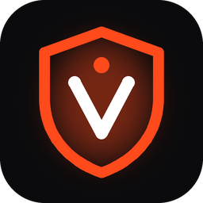

<p align="center">
  
</p>

<h1 align="center">Sentivyre</h1>
<p align="center"><b>AI cybersecurity for your PC, by Vyrelock Technologies</b><br>
<i>Lock your digital world.</i></p>

---

## About

**Sentivyre** is a Windows app that protects you from scams, fake websites and weak passwords, and explains every threat in simple words.

It is made by **Vyrelock Technologies**, a startup founded by **Hasan Bhatti** in Dubai, UAE. Its mission is to make cybersecurity simple, affordable and available to everyone.

## Features

| Feature | What it does |
|---|---|
| 🛡️ **Dashboard** | Safety score, scans run, threats caught and recent activity |
| 🖥️ **PC Scan** | Quick and full scans for dangerous files (fake file types, risky programs, start-up scripts), with Microsoft Defender as a second opinion |
| ⬇️ **Download Shield** | Checks every new file in your Downloads folder the moment it arrives, and warns you if it's dangerous |
| 🔒 **Quarantine** | Moves dangerous files somewhere they can't run, with Restore and Delete forever |
| ✉️ **Scam Scanner** | Paste an SMS, email or WhatsApp message to find out if it's a scam (AI or offline rules) |
| 🔗 **Link Checker** | Spots fake and phishing links: look-alike brands, unsafe domains, shortened links, IP addresses |
| 🔑 **Password Guardian** | Shows password strength and time to crack, and makes strong passwords. Nothing leaves your PC. |
| 🤖 **Vyra AI Assistant** | An AI chat for security questions in English or Arabic |
| ⚠️ **Panic Button** | A step-by-step checklist to follow if you've been hacked |
| ⚙️ **Settings** | Account login, app lock with PIN, notifications, AI connection, automatic updates, start with Windows and protection from the system tray |

## Download & install

1. Go to the [**Releases**](https://github.com/CreoVisionTech/sentivyre/releases/latest) page.
2. Download **`Sentivyre-Setup-x.x.x.exe`**.
3. Open it and follow the steps. Sentivyre gets a desktop shortcut and a Start menu entry.

> **"Windows protected your PC"?** The app isn't code-signed yet, so Windows SmartScreen may show this warning. Click **More info → Run anyway**.

**Requirements:** Windows 10 or 11 (64-bit). No administrator rights needed.

**To uninstall:** Windows Settings → Apps → *Sentivyre by Vyrelock* → Uninstall.

## Automatic updates

Sentivyre updates itself from this repo's GitHub Releases:

- When the app opens (and every 4 hours after that), it reads **`latest.yml`** from the newest release.
- If there's a newer version, it downloads the new setup file in the background.
- The update installs when you close Sentivyre, or straight away if you click **Settings → Restart & update**.

You can turn automatic updates on or off in **Settings → Updates**.

## AI features (optional)

Vyra and the AI scam scan use Claude. To turn them on:

1. Get an API key from [console.anthropic.com](https://console.anthropic.com).
2. In Sentivyre, open **Settings → AI connection** and paste the key.

Without a key, the Scam Scanner and Link Checker still work offline with built-in rules. The key is stored only on your PC.

---

## For developers

### Project structure

```
sentivyre/
├── main.js                  # App window, auto-updater, AI requests
├── preload.js               # Safe bridge between the window and the app
├── scanner.js               # PC Scan, Download Shield and quarantine
├── src/
│   ├── index.html           # The whole app interface
│   └── icon.png
├── build/
│   ├── icon.ico             # App and installer icon
│   └── icon.png
├── installer/
│   └── installer.nsi        # Windows setup (NSIS)
├── scripts/
│   ├── build-win.js         # Builds the setup file and latest.yml
│   └── set-exe-info.js      # Puts the icon and version on Sentivyre.exe
└── .github/workflows/
    └── release.yml          # Builds and publishes a release on each version tag
```

### Run it on your PC

```bash
npm install
npm start
```

### Build the setup file yourself

Requires [NSIS](https://nsis.sourceforge.io/Download) (on Windows, install it to the default folder; on Linux, run `sudo apt install nsis`).

```bash
npm run dist
```

This creates:

- `dist/Sentivyre-Setup-<version>.exe`, the **setup file**
- `dist/latest.yml`, the **update file** the app uses to find new versions

### Publish a new version

1. Change `"version"` in **`package.json`** (e.g. `1.1.0` → `1.2.0`).
2. Add the new version to the top of `CHANGELOG` in **`src/index.html`** (it appears in *Settings → What's new*).
3. Commit and push a tag:

```bash
git add .
git commit -m "Sentivyre 1.2.0"
git tag v1.2.0
git push origin main --tags
```

GitHub Actions then builds the setup file and `latest.yml` and attaches them to a new release. Everyone with Sentivyre installed gets the update automatically.

> To publish by hand instead: run `npm run dist`, create a release on GitHub named `v1.2.0`, and upload **both** `Sentivyre-Setup-1.2.0.exe` and `latest.yml`.

---

## Contact

**Vyrelock Technologies** · Dubai, UAE<br>
📧 creovisiontech4@gmail.com<br>
💼 [Hasan Bhatti on LinkedIn](https://www.linkedin.com/in/hasan-bhatti-879385328/)

© 2026 Vyrelock Technologies. All rights reserved.
